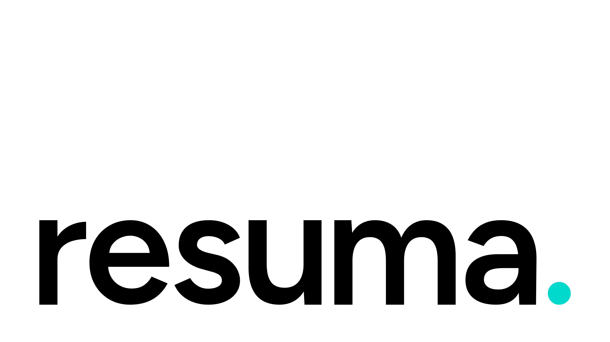

# 

The website for [Resuma](https://github.com/nikolchaa/resuma), a free, open-source desktop app for building resumes, live at [resuma.download](https://resuma.download).

This repository holds only the website. The app, its releases, and its legal documents live in [nikolchaa/resuma](https://github.com/nikolchaa/resuma), and the site links to them there:

- [Privacy Policy](https://github.com/nikolchaa/resuma/blob/main/PRIVACY.md)
- [Terms of Service](https://github.com/nikolchaa/resuma/blob/main/TERMS.md)
- [Trademark Policy](https://github.com/nikolchaa/resuma/blob/main/TRADEMARK.md)
- [Third-Party Software Disclosure](https://github.com/nikolchaa/resuma/blob/main/THIRD_PARTY.md)

## What's here

- `src/`: the page, built with Preact, Vite, and Tailwind CSS, and prerendered to static HTML at build time.
  - `src/components/`: the page's sections, such as the header with the download buttons, the feature overview (`Bento.tsx`), the system requirements, and the footer.
  - `src/content/faq.ts`: the FAQ answers, which also fill the page's FAQ structured data.
- `public/`: files served as they are, such as `robots.txt`, `sitemap.xml`, `llms.txt`, and the icons.
- `netlify/functions/`: `latest-release` finds the latest release's installer for each platform on GitHub for the download buttons, and `stars` the repository's star count. Netlify caches both answers.
- `netlify.toml`: response headers for caching and security. Build settings live in the Netlify UI.

## Development

```bash
git clone https://github.com/nikolchaa/resuma-site.git
cd resuma-site
npm install
npm run dev
```

`npm run build` writes the site to `dist/`, and `npm run preview` serves that build. The build also looks up the latest release, so the download buttons work before the Netlify function answers.

## Contributing

Issues and pull requests about the website are welcome here. Anything about the app itself goes to [nikolchaa/resuma](https://github.com/nikolchaa/resuma).

## Trademark

"Resuma™" and the Resuma™ logo are trademarks of Nikola Ranđelović. See the [Trademark Policy](https://github.com/nikolchaa/resuma/blob/main/TRADEMARK.md) for details.
